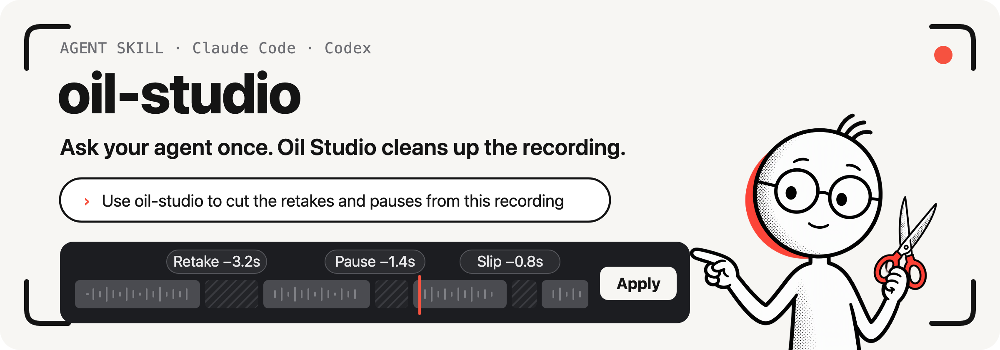

<p align="center">
  
</p>

<p align="center"><b>English</b> · <a href="#简体中文">简体中文</a></p>

# Oil Studio Agent Skill

Let Claude Code, Codex, and other agents record and edit screen recordings with [Oil Studio](https://studio.oiloil.org/en/): cut retakes, slips, and pauses, proofread captions, add chapters, synthesize AI narration, and export the finished video. The agent listens, looks, and decides; Oil Studio does the editing. Editing proposals await review, while caption corrections and chapters apply immediately and can be undone.

> **中文简介：** 让 Claude Code、Codex 等 AI Agent 调用 macOS 原生录屏与剪辑工具 [Oil Studio](https://studio.oiloil.org) 自动录制应用演示、按文字稿精剪重说与口误、收紧停顿、校对并翻译字幕、生成章节与 AI 配音，并导出 60 fps 成片。详见下方[简体中文说明](#简体中文)。

## Try it

Once it’s installed, say this to Claude Code or Codex:

```text
Use oil-studio to cut the retakes and pauses from this recording
```

```text
Use oil-studio to record a walkthrough of this webpage and export it
```

```text
Proofread this project’s captions, translate them into English, and export an SRT file
```

## What it can do

- **Voice-over editing:** remove retakes, slips, abandoned sentences, and extra pauses.
- **Captions & AI narration:** generate captions, fix misheard words, names, capitalization, and line breaks, translate them into English, synthesize AI voice-over narration aligned to captions, and add chapter progress to longer videos.
- **Demo recording:** the agent operates an app or webpage while Oil Studio records only the window you choose.
- **Idle time:** remove the waits between actions.
- **Zooms and chapters:** zoom in on what’s being explained, and divide the video into chapters.
- **Export:** MP4 or GIF videos, or SRT subtitle files.

## How it works

1. The agent reads the project’s transcript, audio, and frames through the `oilstudio` command-line tool. It never reads or writes project files directly.
2. It writes the cuts, caption edits, and zooms as a **proposal**, which Oil Studio validates before accepting.
3. Review and apply editing and zoom proposals in the app. Caption corrections and chapters apply immediately. Every applied change can be undone with ⌘Z.

## Get started

**Requirements:** a Mac with Apple silicon running macOS 15 or later, and Oil Studio ([website](https://studio.oiloil.org/en/) · [download](https://download.oiloil.org/studio/OilStudio.dmg) · `brew install --cask oil-oil/tap/oil-studio`) at or above `metadata.minAppVersion` in [SKILL.en.md](oil-studio/en/SKILL.en.md).

**Recommended: install from the app.** In Oil Studio, open Settings › AI Agent and click Install. The app installs the Skill and the `oilstudio` command-line tool, and keeps both up to date with the app.

**Or install with the Skills CLI (`skills.sh`):**

```sh
npx skills add oil-oil/oil-studio-skill
```

**Or install from GitHub.** Clone the repository and link `oil-studio/` into your agents’ Skill folders (existing entries with the same name are left in place):

```sh
git clone https://github.com/oil-oil/oil-studio-skill.git
cd oil-studio-skill
for skill_parent in "$HOME/.agents/skills" "$HOME/.claude/skills" "$HOME/.codex/skills"; do
  mkdir -p "$skill_parent"
  [ -e "$skill_parent/oil-studio" ] || [ -L "$skill_parent/oil-studio" ] ||
    ln -s "$PWD/oil-studio" "$skill_parent/oil-studio"
done
```

Run `git pull --ff-only` in the cloned folder to update. The `oilstudio` command-line tool still comes from the app: click Install once in Settings › AI Agent, and the app lists your manual copy as External Installation and leaves it in place.

**Check it:** run `oilstudio status`. If you see `app.version`, the command-line tool is ready.

<details>
<summary>Optional dependencies: web playbooks and filler-word checks</summary>

- Python 3: the filler-word coverage check and web playbooks.
- node: both web playbook modes.
- The ego-browser command-line tool: the default browser mode for web playbooks.
- Xcode Command Line Tools (swiftc): the `stage-window` mode for web playbooks.

Editing, captions, and export work without them. See [Web playbooks](oil-studio/en/references/recording.md#web-playbooks).

</details>

## Data and privacy

- The agent works with projects only through `oilstudio`. Projects from other recording apps are imported read-only; the originals are never changed.
- On-device transcription doesn’t upload audio. If you choose Alibaba Cloud Bailian, the project’s audio is uploaded to the region you select.
- API keys are set only in the app. The Skill never receives, stores, or displays them.
- Recording needs your permission in both macOS and Oil Studio; the agent can’t grant it for you.

For more detail, see [Data, permissions, and boundaries](oil-studio/README.md#data-permissions-and-boundaries).

## Versions and compatibility

The Skill version is `metadata.version` in the SKILL file, and the minimum app version is `metadata.minAppVersion`. Both language entries always match.

Before each task, the agent reports its Skill version to `oilstudio status` and follows the compatibility result to update the Skill or app. App-managed Skills update with the app; start a new agent session to load the update.

The agent follows the [English](oil-studio/en/SKILL.en.md) or [Chinese](oil-studio/SKILL.md) instructions based on your conversation language. Both handle Chinese and English voice-overs.

## Development

```sh
python3 -B -m unittest discover -s tests
```

Any change under `oil-studio/` requires a version bump in both `oil-studio/SKILL.md` and `oil-studio/en/SKILL.en.md`. Then run `python3 -B tests/test_skill_version.py --update` to refresh the version record.

## License

The Skill is open source under the [MIT License](LICENSE). The Oil Studio app is proprietary, paid software and isn’t covered by this license.

---

<a id="简体中文"></a>

# 简体中文

<p align="center">
  
</p>

让 Claude Code、Codex 等 Agent 用 [Oil Studio](https://studio.oiloil.org) 录制和精剪录屏：删掉重说、口误和停顿，校对字幕，生成章节与 AI 配音，再导出成片。Agent 负责听、看和判断，Oil Studio 负责执行；剪辑方案由你在 App 里确认，字幕校对和章节直接生效并可撤销。

## 试一句

装好之后，在 Claude Code 或 Codex 里直接说：

```text
用 oil-studio 剪掉这个录屏里的重说和停顿
```

```text
用 oil-studio 录一段这个网页的操作演示并导出
```

```text
校对这个工程的字幕，再生成英文字幕并导出 SRT
```

## 能做什么

- **精剪口播**：删重说、口误、说到一半放弃的话和多余的停顿。
- **字幕与 AI 配音**：生成字幕，校对错词、专有名词、大小写和断行，翻译成英文，按字幕时间轴合成 AI 配音；长视频可顺便生成章节进度。
- **录制演示**：Agent 操作应用或网页，Oil Studio 只录你指定的那个窗口。
- **删空档**：去掉操作之间没有内容的等待。
- **缩放与章节**：推近正在讲解的细节，按内容划分章节。
- **导出**：MP4 / GIF 成片，或 SRT 字幕文件。

## 开始使用

**需要：** macOS 15 及以上的 Apple 芯片 Mac，以及 Oil Studio（[官网](https://studio.oiloil.org) · [下载](https://download.oiloil.org/studio/OilStudio.dmg)），版本不低于 [SKILL.md](oil-studio/SKILL.md) 中的 `metadata.minAppVersion`。

**推荐：由 App 安装。** 打开 Oil Studio「设置 › AI Agent」，点“安装”。App 会安装 Skill 和命令行 `oilstudio`，并随 App 一起更新。

**或者用 Skills CLI 安装：**

```sh
npx skills add oil-oil/oil-studio-skill
```

**或者从 GitHub 克隆安装：**

```sh
git clone https://github.com/oil-oil/oil-studio-skill.git
cd oil-studio-skill
for skill_parent in "$HOME/.agents/skills" "$HOME/.claude/skills" "$HOME/.codex/skills"; do
  mkdir -p "$skill_parent"
  [ -e "$skill_parent/oil-studio" ] || [ -L "$skill_parent/oil-studio" ] ||
    ln -s "$PWD/oil-studio" "$skill_parent/oil-studio"
done
```

更多说明见[数据、权限与边界](oil-studio/README.md#数据权限与边界)。
