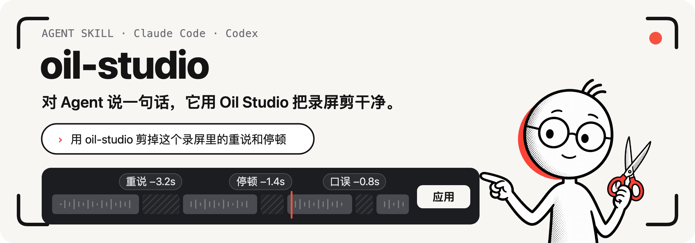

<p align="center">
  
</p>

<p align="center"><b>简体中文</b> · <a href="README.en.md">English</a></p>

# Oil Studio Agent Skill

让 Claude Code、Codex 等 Agent 用 [Oil Studio](https://studio.oiloil.org) 录制和精剪录屏：删掉重说、口误和停顿，校对字幕，生成章节，再导出成片。Agent 负责听、看和判断，Oil Studio 负责执行；剪辑方案由你在 App 里确认，字幕校对和章节直接生效并可撤销。

## 试一句

装好之后，在 Claude Code 或 Codex 里直接说：

```text
用 oil-studio 剪掉这个录屏里的重说和停顿
```

```text
用 oil-studio 录一段这个网页的操作演示并导出
```

```text
校对这个工程的字幕，再生成英文字幕并导出 SRT
```

## 能做什么

- **精剪口播**：删重说、口误、说到一半放弃的话和多余的停顿。
- **字幕**：生成字幕，校对错词、专有名词、大小写和断行，翻译成英文；长视频可顺便生成章节进度。
- **录制演示**：Agent 操作应用或网页，Oil Studio 只录你指定的那个窗口。
- **删空档**：去掉操作之间没有内容的等待。
- **缩放与章节**：推近正在讲解的细节，按内容划分章节。
- **导出**：MP4 / GIF 成片，或 SRT 字幕文件。

## 怎么工作

1. Agent 通过命令行 `oilstudio` 读取工程的转录、声音和画面，不直接读写工程文件。
2. 它把要删的段落、字幕修改和缩放写成**提案**，Oil Studio 先校验再接收。
3. 剪辑与缩放方案可在 App 里逐条查看和应用；字幕校对与章节直接生效。所有已应用的修改都可以 ⌘Z 撤销。

## 开始使用

**需要：** macOS 15 及以上的 Apple 芯片 Mac，以及 Oil Studio（[官网](https://studio.oiloil.org) · [下载](https://download.oiloil.org/studio/OilStudio.dmg)），版本不低于 [SKILL.md](oil-studio/SKILL.md) 中的 `metadata.minAppVersion`。

**推荐：由 App 安装。** 打开 Oil Studio「设置 › AI Agent」，点“安装”。App 会安装 Skill 和命令行 `oilstudio`，并随 App 一起更新。

**或者从 GitHub 安装。** 克隆仓库，把 `oil-studio/` 链接到 Agent 的 Skill 目录（已存在的同名项会保留）：

```sh
git clone https://github.com/oil-oil/oil-studio-skill.git
cd oil-studio-skill
for skill_parent in "$HOME/.agents/skills" "$HOME/.claude/skills" "$HOME/.codex/skills"; do
  mkdir -p "$skill_parent"
  [ -e "$skill_parent/oil-studio" ] || [ -L "$skill_parent/oil-studio" ] ||
    ln -s "$PWD/oil-studio" "$skill_parent/oil-studio"
done
```

之后在克隆目录运行 `git pull --ff-only` 更新。命令行 `oilstudio` 仍由 App 安装：在「设置 › AI Agent」点一次“安装”，App 会把手动装的 Skill 显示为“外部安装”并保留它。

**检查一下：** 运行 `oilstudio status`，能看到 `app.version` 就说明命令行可用。

<details>
<summary>可选依赖：网页 Playbook 与口头禅检查</summary>

- Python 3：口头禅覆盖检查和网页 Playbook。
- node：网页 Playbook 的两种模式都需要。
- ego-browser 命令行：网页 Playbook 的默认浏览器模式。
- Xcode 命令行工具（swiftc）：网页 Playbook 的 `stage-window` 模式。

没有这些也不影响精剪、字幕和导出。详见[网页 Playbook](oil-studio/references/recording.md#网页-playbook)。

</details>

## 数据与隐私

- Agent 只通过 `oilstudio` 访问工程；旧录屏工程先只读导入，原件不改动。
- 本机识别不上传音频。选用阿里云百炼识别时，工程录音会上传到你选择的地域。
- API Key 只在 App 里配置，Skill 不接收、不保存、不显示密钥。
- 录制需要你在 macOS 和 Oil Studio 里分别授权，Agent 不能替你点允许。

更多说明见[数据、权限与边界](oil-studio/README.md#数据权限与边界)。

## 版本与兼容

Skill 的版本号是 SKILL 文件里的 `metadata.version`，所需最低 App 版本是 `metadata.minAppVersion`，中英文两个入口保持一致。

每次开始任务前，Agent 会带上当前 Skill 版本运行 `oilstudio status`，根据兼容性结果更新 Skill 或 App。App 管理的 Skill 随 App 更新；已有会话需要重新开启。

Agent 按对话语言选择[中文指令](oil-studio/SKILL.md)或[英文指令](oil-studio/en/SKILL.en.md)，两版都支持中英文口播。

## 开发

```sh
python3 -B -m unittest discover -s tests
```

改动 `oil-studio/` 里的任何文件，都要同时提升 `oil-studio/SKILL.md` 和 `oil-studio/en/SKILL.en.md` 的 `metadata.version`，再运行 `python3 -B tests/test_skill_version.py --update` 更新版本记录。

## 许可证

Skill 按 [MIT 许可证](LICENSE)开源。Oil Studio App 是闭源付费软件，不在此许可范围内。
